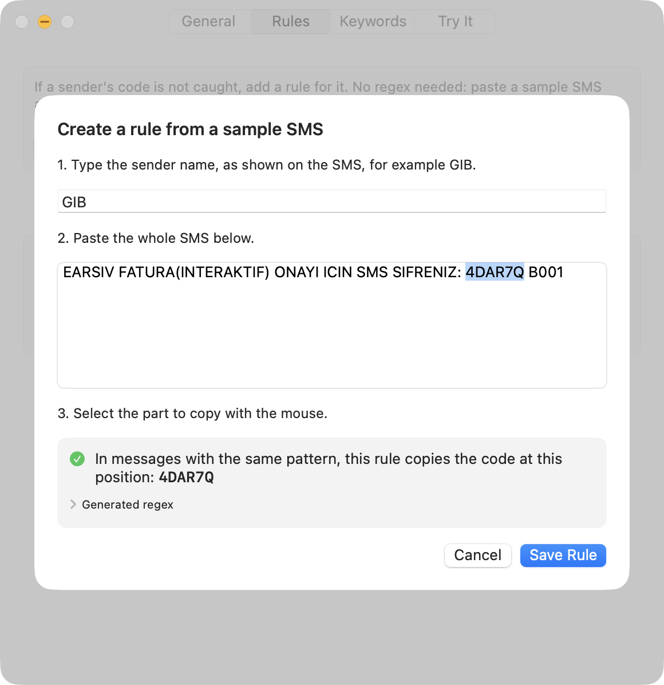
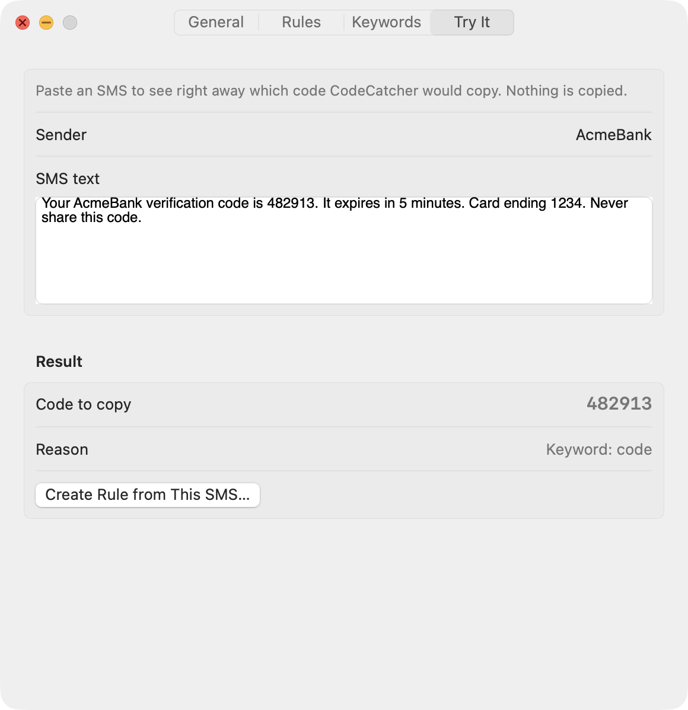
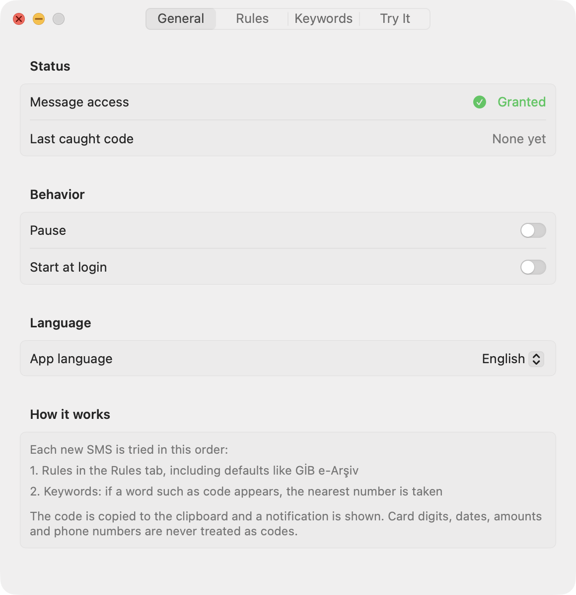
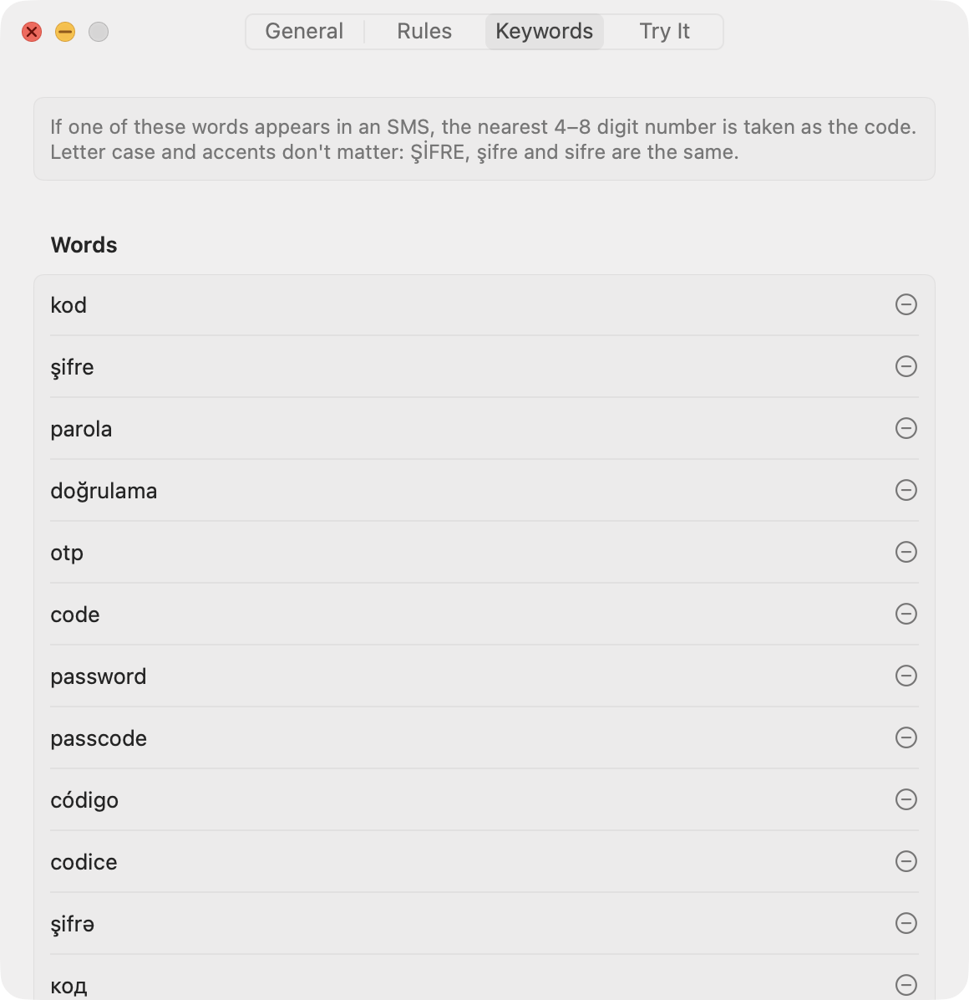
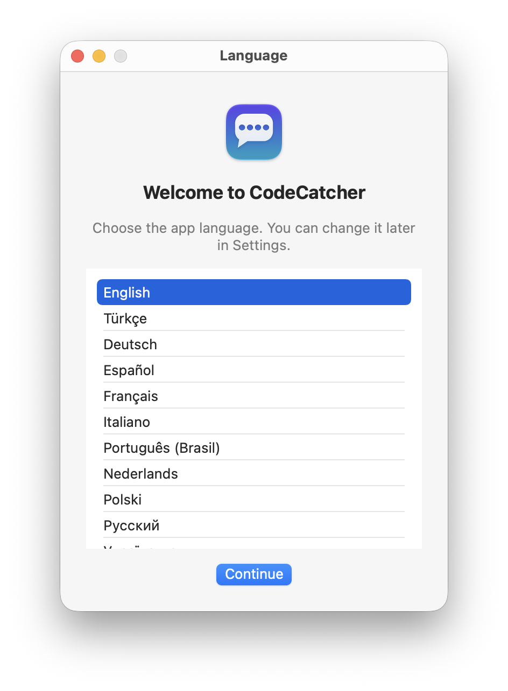

# CodeCatcher

[](https://github.com/sponsors/sineld)

**他の言語で読む：** [English](../README.md) · [Türkçe](README.tr.md) · [Deutsch](README.de.md) · [Español](README.es.md) · [Français](README.fr.md) · [Italiano](README.it.md) · [Português (Brasil)](README.pt-BR.md) · [Nederlands](README.nl.md) · [Polski](README.pl.md) · [Русский](README.ru.md) · [Українська](README.uk.md) · [Kurdî](README.ku.md) · [Azərbaycan dili](README.az.md) · [العربية](README.ar.md) · [فارسی](README.fa.md) · [简体中文](README.zh-Hans.md) · 日本語 · [한국어](README.ko.md)

iPhoneから転送されたSMSメッセージに含まれるワンタイム確認コードを取得し、クリップボードにコピーするmacOSのメニューバーアプリです。依存関係はなく、SwiftUI、Foundation、システムのSQLiteだけで動作します。

CodeCatcherは無料のオープンソースソフトウェアです。個人プロジェクトとして開発されたもので、現状のまま提供され、サポートやアップデートの保証はありません。バグ報告やコントリビューションを歓迎します。時間の節約に役立ったら、[GitHub Sponsors](https://github.com/sponsors/sineld)で開発を支援していただけます。

## 機能

- **メッセージを取りこぼさない：** 最後に処理したメッセージ以降の新しいSMSを、すべて順番に処理します。macOS 13以降、ほとんどのメッセージの本文は`attributedBody`カラムにのみ保存されていますが、そうしたメッセージも読み取ります。
- **正しい数字を選ぶ：** カード番号、日付、時刻、金額、電話番号、キャンペーン配信停止用の番号は除外され、キーワードに最も近い数字がコードとして取得されます。
- **多くの言語を理解：** 18言語のキーワードが組み込まれており、数字が文字のすぐ隣に書かれる中国語、日本語、韓国語のメッセージにも対応します。大文字・小文字やアクセントは区別されず、トルコ語も同様です：ŞİFRE, şifreとsifreは同じものとして扱われます。
- **regex不要のルール：** サンプルSMSをペーストしてコードを選択するだけで、ルールが自動的に作成され、サンプルでテストされます。
- **GİB e-Arşiv：** トルコ歳入庁が発行するe-Arşiv請求書のパスワードは英字を含みますが、デフォルトルールで取得できます。
- **18のインターフェイス言語：** 初回起動時に選択し、設定で変更できます。
- **プライバシー：** メッセージはこのMac上でのみ、読み取り専用で読み込まれます。ネットワーク経由で送信されるものは何もありません。

**動作環境：** macOS 15以降、ビルドにはXcode 16以降、iPhoneのSMS/MMS転送。

## スクリーンショット

| サンプルSMSからルールを作成 | テスト |
|:---:|:---:|
|  |  |
| **一般** | **キーワード** |
|  |  |

<p align="center"><br><em>言語</em></p>

## インストール

### ダウンロード

1. [最新リリース](https://github.com/sineld/CodeCatcher/releases/latest)から`.dmg`ファイルをダウンロードします。Appleシリコン搭載のMacとIntel搭載のMacの両方で動作するユニバーサルアプリです。
2. DMGを開き、CodeCatcherをアプリケーションフォルダにドラッグします。
3. このアプリはAppleの公証を受けていないため、初回はmacOSによってブロックされます。一度開こうとしてから、システム設定 → プライバシーとセキュリティ に移動して**このまま開く**をクリックしてください。または、ターミナルで次のコマンドを実行します：

   ```bash
   xattr -dr com.apple.quarantine /Applications/CodeCatcher.app
   ```

### ソースからビルド

```bash
scripts/build-app.sh --install   # builds, installs to ~/Applications and launches
```

**署名（推奨）：** フルディスクアクセスの権限はアプリの署名に紐づいています。アドホック署名では、再ビルドのたびに権限を付与し直す必要があります。これを避けるには、キーチェーンアクセス → 証明書アシスタント → 証明書を作成 で、`CodeCatcher Local`という名前の証明書を一度だけ作成してください（固有情報のタイプ：自己署名ルート、証明書のタイプ：コード署名）。スクリプトはこの証明書が見つかれば使用します。別の証明書を使うには：`CODESIGN_IDENTITY="…" scripts/build-app.sh`。

### インストール後

1. **フルディスクアクセス：** システム設定 → プライバシーとセキュリティ → フルディスクアクセス → CodeCatcher。これがないと`~/Library/Messages/chat.db`を読み込めず、メニューバーに⚠︎アイコンが表示されます。
2. iPhoneで、設定 → メッセージ → SMS/MMS転送 でこのMacをオンにします。

## 言語

CodeCatcherは初回起動時に使用する言語を尋ね、その選択を記憶します。あとで 設定 → 一般 → 言語 で変更でき、変更を適用するためにアプリが再起動します。

対応言語：English、Türkçe、Deutsch、Español、Français、Italiano、Português (Brasil)、Nederlands、Polski、Русский、Українська、Kurdî (Kurmancî)、Azərbaycan dili、العربية、فارسی、简体中文、日本語、한국어。

インターフェイスの言語によって、取得されるメッセージが制限されることはありません。対応するすべての言語のキーワードがデフォルトで有効になっています。

## コードの選び方

新しいメッセージごとに、次の順序で試行します：

1. **ルール：** 設定 → ルール のリストの順に試行され、最初に一致したルールでコードが決まります。regexの知識は不要です。下の「サンプルSMSからのルール」を参照してください。

   以下のデフォルトルールは、初回起動時に一度だけリストに追加されます。ほかのルールと同様に編集・削除でき、削除したルールが自動的に戻ることはありません。**削除したデフォルトルールを復元**で元に戻せます。

   | ルール | 送信元 | Regex | 理由 |
   |---|---|---|---|
   | GİB e-Arşiv | `GIB` | `SIFRENIZ:\s*([A-Z0-9]{4,8})\b` | e-Arşiv請求書のパスワードは6文字で英字を含み、英字のみのものもあるため |

2. **キーワード：** メッセージにキーワードのいずれかが含まれる場合、4〜8桁の数字、または`123 456`形式の数字が候補になります。デフォルトのキーワードは対応するすべての言語をカバーしています：`kod, şifre, parola, doğrulama, otp, code, password, passcode, código, codice, şifrə, код, пароль, رمز, کد, 验证码, 动态码, コード, 인증`。
   - **除外されるもの：** 日付、時刻、金額の一部、電話番号やIBANの数字グループ、`TL`、`₺`、`USD`などの通貨が続く金額、「ile biten」や「son 4 hanesi」などのカードに関する表現、「no:」に続く注文番号、キャンペーン配信停止用の番号（「3340'e RET yaz」、「OBRET->3340」）。
   - 残った候補のうち、キーワードに最も近いものが選ばれます。距離が同じ場合は、キーワードの後にあるものが優先されます。

コードはクリップボードにコピーされ、通知が表示されます。スリープ解除後に同期されたメッセージなど、10分より前のメッセージは無視されます。

### サンプルSMSからのルール

送信元のコードが取得されない場合は、設定 → ルール → **サンプルSMSからルールを作成…** に進みます：

1. 送信元名を入力します（例：`GIB`）。
2. SMSの全文をペーストします。
3. コピーする部分をマウスで選択します。

CodeCatcherがルールを自動で作成します：
- コードの前にある固定の単語がアンカーとして使われます。ない場合は、コードの後の単語が使われます。
- コードは、その形に一致するパターンに置き換えられます：数字のみ、または英字と数字で、長さが近いもの。
- 保存前に、ルールはサンプルSMSでテストされます。選択したコードを正確に取得できない場合は保存できません。

たとえば、`… SMS SIFRENIZ: 4DAR7Q B001`で`4DAR7Q`を選択すると、`SMS\s+SIFRENIZ\s*:\s*([A-Z0-9]{4,8})`で始まるルールが作成されます。このルールは`ZPQRTT`のような英字のみのパスワードも取得します。生成されたregexはウインドウに表示され、リストでルールを展開すれば手動で編集できます。

**テスト**タブでは、SMSをペーストすると、どのコードとどのルールが選ばれるかをすぐに確認できます。そこからルールを作成することもできます。

## 実際のメッセージでテストする

```bash
~/Applications/CodeCatcher.app/Contents/MacOS/CodeCatcher --dry-run 100          # digits masked
~/Applications/CodeCatcher.app/Contents/MacOS/CodeCatcher --dry-run 100 --plain  # as is
```

直近N件の受信メッセージをスキャンし、それぞれについて選ばれたコードとその取得元を出力します。テキスト内のコードの位置は`⟦CODE⟧`で示されます。何もコピーされません。ターミナルにフルディスクアクセスが必要です。

## 開発

GitHub Actionsは、プッシュとプルリクエストのたびに`swift test`を実行します。

```bash
swift test                          # tests
scripts/build-app.sh                # build/CodeCatcher.app (universal: arm64 + x86_64)
scripts/build-app.sh --dmg          # build/CodeCatcher-<version>.dmg for a release
xcrun swift scripts/make-icon.swift # regenerates Resources/AppIcon.icns
```

```
Sources/CodeCatcher/
  App.swift            menu bar, polling loop, clipboard, notification, About, --dry-run
  Language.swift       interface languages, first-launch picker, restart
  MessageStore.swift   read-only chat.db access, attributedBody decoding
  CodeExtractor.swift  language-aware folding, rules, candidate selection and filtering
  RuleBuilder.swift    building a rule from a sample SMS and a selection
  SettingsView.swift   General, Rules, Keywords and Try It tabs
Resources/Localizations/
  <language>.lproj/Localizable.strings   interface translations; en is the source
Tests/CodeCatcherTests/
  CodeExtractorTests.swift   examples derived from real SMS templates (codes are made up)
  RuleBuilderTests.swift     a rule built from a sample works on other SMS of the same template
  RuleStorageTests.swift     default rules are added once, deleted and restored
  MessageStoreTests.swift    reading tests on a temporary chat.db copy
  LocalizationTests.swift    every interface string exists in every language
```

**翻訳：** キーは`Sources/`内の英語の文字列です。文字列を追加・変更するには、`en.lproj`とほかのすべての言語を更新してください。キーや`%@`プレースホルダが欠けていると`LocalizationTests`が失敗します。ネイティブスピーカーによる修正を大いに歓迎します。

## プライバシー

メッセージはこのMac上の`chat.db`から、読み取り専用でのみ読み込まれます。ネットワーク経由で送信されることも、ディスクに書き込まれることもありません。テスト内のSMSはすべて架空のものです。

取得したコードはクリップボードにコピーされるため、クリップボード履歴アプリにもこれらのコードが保存されます。

## サポート

CodeCatcherは無料です。開発を支援したい場合は、[GitHub Sponsors](https://github.com/sponsors/sineld)でスポンサーになることができます。リポジトリへのスターや問題の報告も助けになります。

## ライセンス

[MIT](../LICENSE)

## 開発者

Sinan Eldem · [sinan@sinaneldem.tr](mailto:sinan@sinaneldem.tr) · [sinaneldem.tr](https://sinaneldem.tr)
